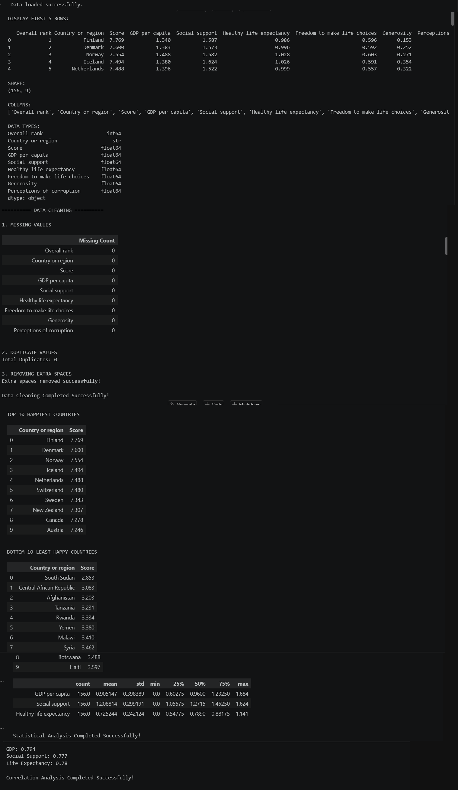

# 🌍 World Happiness Report Analysis

>  A Python data analysis project that explores what makes countries happy using GDP, social support, and life expectancy.

## 📖 Project Description

This project analyzes the **World Happiness Report** dataset using Python. It loads and cleans the data, identifies the happiest and least happy countries, and studies how factors like GDP per capita, social support, and healthy life expectancy relate to happiness scores. The results are presented through statistical summaries, correlation analysis, and clear visualizations.

## ✨ Features

- 📥 **Data Loading** – Reads the happiness dataset from a CSV file
- 🔍 **Data Exploration** – Views the first rows, shape, column names, and data types
- 🧹 **Data Cleaning**
  - Detects and removes missing values
  - Finds and removes duplicate records
  - Strips extra spaces from text columns
- 🏆 **Top 10 Happiest Countries** – Ranks countries with the highest happiness scores
- 📉 **Bottom 10 Least Happy Countries** – Ranks countries with the lowest happiness scores
- 📊 **Statistical Analysis** – Summary statistics for GDP per capita, social support, and healthy life expectancy
- 🔗 **Correlation Analysis** – Measures how happiness score relates to GDP, social support, and life expectancy
- 📈 **Data Visualization**
  - Bar charts for the top 10 and bottom 10 countries
  - Scatter plots for GDP, social support, and life expectancy vs. happiness score

## 🛠️ Technologies Used

- 🐍 **Python 3**
- 🐼 **Pandas** – data loading, cleaning, and analysis
- 📉 **Matplotlib** – plotting charts
- 🎨 **Seaborn** – statistical visualizations
- 📓 **Jupyter Notebook** – interactive development environment

## 🚀 How to Run / Installation

1. **Clone the repository**
   ```bash
   git clone https://github.com/princy1806/Final_project.git
   cd world-happiness-analysis
   ```

2. **Install the required libraries**
   ```bash
   pip install pandas matplotlib seaborn jupyter
   ```

3. **Place the dataset** (`happiness.csv`) in the project folder

4. **Launch Jupyter Notebook**
   ```bash
   jupyter notebook
   ```

5. **Open the notebook** and run all cells from top to bottom ▶️

## 📁 Project Structure

```
├── main.ipynb   
├── happiness.csv 
├── README.md
├── output.png
├── visualization.png
                  
```
## Output



## 👩‍💻 Author / Developer

**Pansuriya Princy**
